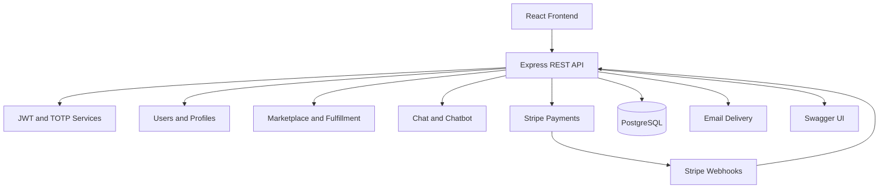

# Brand Connect API

REST API for the Brand Connect marketplace, a full-stack platform connecting brands and content creators.

This service provides authentication, MFA, profiles, marketplace operations, Stripe payments and subscriptions, messaging, fulfillment workflows, email, and administrative endpoints.

## Project Status

The API is an in-development backend prototype with Swagger documentation and an Azure deployment workflow.

Implemented areas include:

- Registration and login with JWT
- Email verification and TOTP MFA
- User, creator, and client profile management
- Marketplace listings and creator discovery
- Stripe checkout, payments, and webhook handling
- Subscription routes
- Chat and chatbot integrations
- Fulfillment and administrative routes
- Swagger UI at `/api-docs`
- PostgreSQL connection and database health endpoint
- Docker and Docker Compose configuration
- GitHub Actions deployment to Azure

This repository does not include a database migration system or a complete test suite. Database schema provisioning must be performed from a separate SQL setup or by the deployment environment.

## Architecture



The application follows a controller/service/route split. Controllers coordinate HTTP behavior, services hold domain logic, middleware validates authentication and roles, and PostgreSQL access is centralized in `src/config/db.js`.

## API Modules

| Prefix | Responsibility |
|---|---|
| `/api/auth` | Registration, login, email verification, MFA |
| `/api/users` | User account operations |
| `/api/profiles` | User and creator profile operations |
| `/api/marketplace` | Marketplace services and creator discovery |
| `/api/payments` | Stripe checkout and payment webhooks |
| `/api/subscriptions` | Subscription checkout and webhooks |
| `/api/chat` | Messaging and conversations |
| `/api/chatbot` | AI assistant endpoints |
| `/api/fulfillment` | Delivery and fulfillment workflow |
| `/api/admin` | Administrative operations |
| `/api/instagram` | Instagram integration |
| `/api/dev` | Development-only routes |

## Technology Stack

| Technology | Role |
|---|---|
| Node.js 22 | JavaScript runtime |
| Express | HTTP API framework |
| PostgreSQL | Primary relational database |
| `pg` | PostgreSQL connection pool |
| JWT | Access authentication |
| Speakeasy | TOTP MFA |
| bcrypt | Password hashing |
| Stripe | Checkout, subscriptions, and webhooks |
| Swagger UI | API documentation |
| Jest and Supertest | Testing tools |
| Docker | Containerized development and deployment |
| Azure App Service | Production deployment target |
| GitHub Actions | Deployment workflow |

## Project Structure

```text
src/
  app.js                 Express setup and route registration
  bootstrap.js           Server entry point
  config/db.js           PostgreSQL pool
  routes/                API route definitions
  controllers/           HTTP request handlers
  services/              Domain and integration logic
  middleware/            Authentication, roles, and errors
  payments/              Stripe checkout and webhooks
  subscriptions/         Subscription flows
  email/                 Email delivery helpers
  docs/swagger.yaml      OpenAPI documentation
.github/workflows/       Azure deployment workflow
docker-compose.yml       Local API and PostgreSQL stack
Dockerfile              Container image
jest.config.cjs         Jest configuration
```

## Requirements

- Node.js 22
- npm
- PostgreSQL 15 or later
- A Stripe account for payment testing
- Optional SMTP provider for email delivery
- Docker and Docker Compose for containerized development

## Environment Variables

Copy `.env.example` to `.env` and replace every placeholder:

```powershell
Copy-Item .env.example .env
```

Important variables:

| Variable | Purpose |
|---|---|
| `PORT` | API port |
| `NODE_ENV` | Environment mode |
| `DB_HOST`, `DB_PORT`, `DB_NAME`, `DB_USER`, `DB_PASSWORD` | PostgreSQL connection |
| `DB_SSL` | Enable SSL for managed PostgreSQL |
| `FRONTEND_URL` | Allowed browser origin |
| `JWT_SECRET` | JWT signing secret |
| `STRIPE_SECRET_KEY` | Stripe server API key |
| `STRIPE_WEBHOOK_SECRET` | Stripe webhook signature secret |
| `SMTP_HOST`, `SMTP_PORT`, `SMTP_USER`, `SMTP_PASSWORD`, `SMTP_FROM` | Email delivery |

Never commit `.env`, Stripe secrets, database passwords, or private keys.

## Local Installation

Install dependencies:

```powershell
npm install
```

Configure PostgreSQL and environment variables:

```powershell
Copy-Item .env.example .env
```

Start the API:

```powershell
npm run dev
```

The server is available at:

- API: `http://localhost:3000`
- Health: `http://localhost:3000/`
- Database check: `http://localhost:3000/test-db`
- Swagger: `http://localhost:3000/api-docs`

## Docker

Start PostgreSQL and the API:

```powershell
docker compose up --build
```

Stop the stack:

```powershell
docker compose down
```

The Compose database uses its own development credentials. Change them before sharing or deploying the stack outside a local environment.

## Frontend

The corresponding frontend is available at:

- [Frontend repository](https://github.com/AndresContreras1034/Frontend-brandconnect)
- [Deployed frontend](https://andrescontreras1034.github.io/Frontend-brandconnect/)

Configure `FRONTEND_URL` as the frontend origin so CORS permits browser requests.

## Stripe

Configure test keys in `.env` and expose the local server to receive webhooks during development.

The application expects raw request bodies for:

- `/api/payments/webhook`
- `/api/subscriptions/webhook`

The webhook secrets must match the Stripe webhook endpoint used by the environment.

## Testing

Run the configured test command:

```powershell
npm test
```

Coverage can be requested with:

```powershell
npm run test:coverage
```

The Jest configuration currently references a `test-QA` directory that is not included in this repository. Tests must be created or that configuration updated before CI can provide meaningful verification.

## Deployment

The GitHub Actions workflow builds the Node.js application and deploys a ZIP artifact to Azure App Service using `AZURE_PUBLISH_PROFILE`.

Production requires:

- Database credentials and SSL configuration
- `JWT_SECRET`
- Stripe production keys and webhook secret
- SMTP configuration
- Public frontend URL
- Public API URL

## Known Limitations

- Database migrations and seed scripts are not included.
- Automated tests are not present in the current repository.
- Environment and deployment variables require a manual review before production use.
- Stripe, email, and chatbot integrations depend on external credentials.
- Development routes are disabled only when `NODE_ENV=production`.
- The deployed environment should validate CORS, webhook endpoints, secrets, and database SSL separately.
